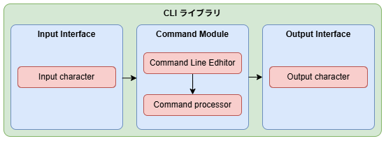
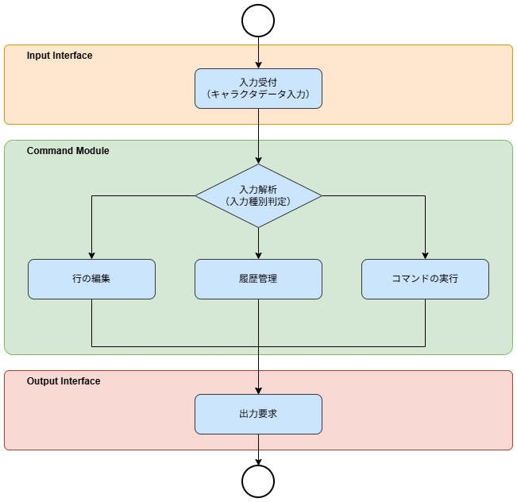

# 概要設計書

---

## 目次

1. [システム概要](#1-システム概要)
2. [機能概要](#2-機能概要)
3. [アーキテクチャ](#3-アーキテクチャ)
4. [制御設計](#4-制御設計)
5. [状態・イベント設計](#5-状態・イベント設計)
6. [データ設計](#6-データ設計)
7. [インターフェース](#7-インターフェース)
8. [エラー設計](#8-エラー設計)
9. [制約事項](#9-制約事項)

---


## 1. システム概要
CLIライブラリは、入力された文字列を解析し、コマンド実行および結果表示を行うライブラリである。  

WindowsやLinux等で使われているshellの仕組み・機能をマイコン等の組み込み機器向けに提供する。  
本ライブラリは入出力デバイスには依存せず、UART、USB、BLE等の通信手段やLCD等の表示装置へ適用できることを目的とする。  


CLIライブラリの責務は以下とする。  
- 入力データ解析
- コマンドラインの編集
- コマンド実行
- 解析・実行結果の出力

以下は責務外とする。  
- 入力・出力デバイス制御

---

## 2. 機能概要
### 2.1 機能一覧
本ライブラリが、要求する機能を以下に記載する。  

- 動的メモリ未使用
- マルチインスタンス対応
- 入出力デバイス非依存
- リアルタイムOS必須ではない
- コマンド編集機能を有する
- コマンド履歴機能を有する
- コマンド登録機能を有する
- printf形式出力を提供する
- ASCII文字を対象とする
- UTF-8等の多バイト文字は対象外

### 2.2 主要ユースケース

- ターミナルソフトを使用する場合の構成例
```text
入力デバイス(キーボード)
↓
入力モジュール(UART)
↓
CLIライブラリ
↓
出力モジュール(UART)
↓
出力デバイス(ターミナルソフトのコンソール画面)
```


- LCDを使用する場合の構成例
```text
入力デバイス(キーボード)
↓
入力モジュール(USB HID)
↓
CLIライブラリ
↓
出力モジュール(LCDデバイスドライバ)
↓
出力デバイス(LCDに描画)
```

---


## 3. アーキテクチャ
### 3.1 システム全体構成
  - システム構成図
  - Application / Middleware / Driver / Hardwareの関係

### 3.2 ソフトウェア構成
本ライブラリは目的に応じた複数の機能により構成される。  

- `Input Interface` -入力データをCLIライブラリへ受け渡すインターフェース
- `Command Module` -CLIの業務ロジックを提供する
- `Output Interface` -CLIが生成したデータを外部へ出力する


ソフトウェア構成図を以下に示す。  



### 3.3 各コンポーネントの責務
モジュール間の関連を示した処理フローを以下に示す。  



### 3.4 依存関係

### 3.5 設計方針

---


## 4. 制御設計
### 4.1 全体フロー
### 4.2 初期化
### 4.3 通常動作
### 4.4 終了処理

---

## 5. 状態・イベント設計
### 5.1 状態
### 5.2 状態遷移
### 5.3 イベント
### 5.4 イベントフロー

---

## 6. データ設計
### 6.1 主要データ
### 6.2 データフロー

---

## 7. インターフェース

### 7.1 公開API
#### Input Interface
入力モジュールが受け取ったキャラクタデータをCLIライブラリに入力するためのインターフェースを提供する。  

#### 提供機能
- 入力受付

#### 公開API
- `cli_input_char`

---


### Command Module
入力データの解析、コマンドライン編集、コマンド実行等の業務ロジックを担当する。  

#### 提供機能
- CLIの主制御
- 行の編集
- 履歴管理
- コマンドの登録
- コマンドの実行

#### 公開API
- `cli_init`
- `cli_handler`
- `cli_cmd_register`
- `cli_cmd_unregister`

---


### Output Interface
CLIライブラリが生成した文字列データを外部へ出力するためのインターフェースを提供する。  

#### 提供機能
- 文字列出力
- printf出力

#### 公開API
- `cli_write`
- `cli_printf`
- `cli_vprintf`
- `cli_putc`

### 7.2 外部依存
### 7.3 Callback / Event

---

## 8. エラー設計
### 8.1 エラー分類
### 8.2 エラー通知
### 8.3 復旧方針

---

## 9. 制約事項
### 9.1 リソース制約
### 9.2 処理時間
### 9.3 メモリ
### 9.4 並行性・排他

---